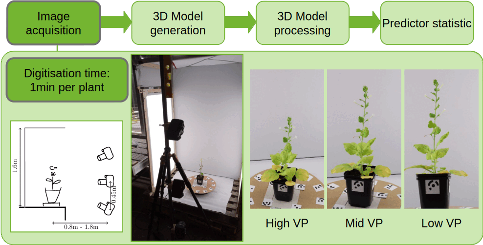
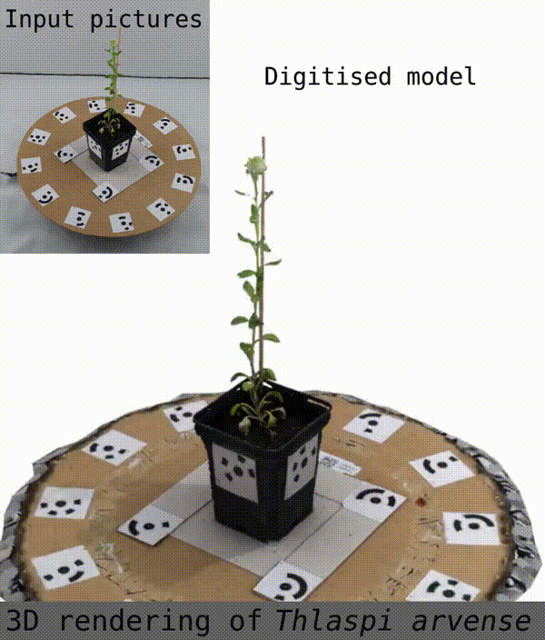

# GreenRobust - a Workflow for the 3D Phenotyping of Greenhouse Plants

## Overview

Set of scripts used for the automation of 3D phenotyping of greenhouse plants
for the [Excellence Cluster GreenRobust](https://greenrobust.de/).

The 3D phenotyping process is split into 4 steps. The scripts related to each
steps is stored into a separate subfolder as such:

1. Image acquisition and preparation &rarr; aa_image_preparation/
2. 3D Model generation &rarr; bb_metashape_plant_digitisation/
3. 3D Model processing &rarr; cc_blender_plant_volume/
4. Predictor statistic &rarr; dd_data_analysis_r/



## Script Details

Each subfolder are independent and help the process of its respective step
*(see [Overview](#overview)*).

### aa_image_preparation

**Overview:**
Bash script which group the images into folders based on file creation time

**Prerequisite:**
Linux operating system with bash and exif.
On Windows, can use [WSL (Windows Subsystem for Linux)](https://learn.microsoft.com/en-us/windows/wsl/install).

On Debian based distribution, exif can be installed with the command:
`sudo apt install exif`

Before using the scripts, download the pictures (as `.JPG`) from each Camera into
a separate folder in the same base folder:

```text
    - Camera_01/
    - Camera_02/
    - Camera_03/
```

While taking the picture, write down the plant label for each plant (in order),
save it into a text file (one plant label per line).
When taking a blank picture (for the background), write Background.

**Usage:**

- In each Camera subfolder:
  - Call `plant_group.sh` to group pictures based on the relative EXIF time
    between each shot
  - Call `plant_rename.sh <plant_name_file>` to rename every folder based on
    the plant label (see Prerequisite above).
    - For the script to work, there should be as many folder created by
      `plant_group` in the current folder as plant label in <plant_name_file>
    - The script only process file which start by "2026" (edit variable in
      script if pictures were taking in another year). This allow the script to
      be run iteratively as it will ignore already renamed folders.
  - Call `plant_background.sh` to copy the backgrounds images with their plant subfolder.
    - If a folder contained more than one background, delete all but the older
      one before running the script.
- Once every Camera folder is process, call `invert_folder` in the folder
  containing the Camera subfolder.
  - This script will invert the Camera and the Plant subfolder, effectively
    grouping all Cameras from one plant in the same subfolder.
  - If some extra empty folders are created, remove them.

### bb_metashape_plant_digitisation

**Overview:**
For each subfolder in the working directory, import images and generate 3D model
based on input images.

**Prerequisite:**
The folder structure containing the images to load in Metashape can have one of
two structures, depending on the masking strategy:

- Masks generated by the script in *(deprecated)* aa_image_preparation: nothing
  to change, the scripts in aa_image_preparation prepare the folder structure
  needed for the Metashape script

- Mask generated in Metashape based on background image *(recommended method)*:
  One background image should be given for each camera position and named:
  "<camera_folder>_background.JPG".
  The background image can be in the plant subfolder or in the whole project
  folder. If one background is present both, the one in the plant subfolder has
  the precedence. Here is an example of folder structure:

```text
    - Plant01/
        - Camera_high/
        - Camera_mid/
        - Camera_low/
        - Camera_high_background.JPG
        - Camera_mid_backgournd.JPG
        - Camera_low_background.JPG
    - Plant02/
        - Camera_high/
        - Camera_mid/
        - Camera_low/
        - Camera_high_background.JPG
        - Camera_mid_backgournd.JPG
        - Camera_low_background.JPG
```

**Usage:**
Call the script `metashape_batchprocess.py` from Metashape (Tools > Run Scripts)
after defining the working directory. The working directory can be changed
directly in the script (by editing the user variable WORKING_DIR) or by
changing the working directory using Metashape console by running the following:

```python
import os
os.chdir(r"<input_folder_path>")
```

If no arguments specified, the script will only process the working directory.
It is possible to specify multiple directory to process by listing the
corresponding directories as arguments (each path separated by a space).

In each processed directory *(by default only the working directory)*, the
script will loop through any subfolder which start with the species initial
*(currently: AT, BD, BR, HS, HV, NB, SD, SL, TA)*.

The saved Metashape and 3D model files are saved in a subfolder of the working
directory defined by the variable output_dir.

### cc_blender_plant_volume

**Overview:**
Cleanup 3D model generated by Metashape and reposition/rescale model to be
aligned with origin and its pot matching the defined dimension. Generate a
table which contains extracted values from the 3D model (volume, plant height,
...).



**Prerequisite:**
Some functions uses the modules not installed in the python version within
blender. To install them in Linux, run the following command:

```bash
<blender_path>/<version>/python/bin/python -m pip install pillow --user
<blender_path>/<version>/python/bin/python -m pip install open3d --user
```

Once installed, replace the path in the variable `LOCAL_LIBRARY` in
`add_module.py` to the path where the module got installed. In my case:
`/home/clement/.local/lib/python3.10/site-packages`

In Windows, the same process can be done using the PowerShell (path in Windows
are \ instead of /).

To find the path to the python executable package with python, you can run the
following code with the python console in Blender:

```python
import sys
print(sys.executable)
```

**Usage:**
Update paths to module and python local library in `add_module.py`:

- MODULE_PATH: The path to this repository (folder containing this `README.md` file)
- LOCAL_LIBRARY: The `site-packages` folder containing the locally installed
  python libraries

Update the variables in `config.json`:

- `WORKING_PATH`: Top directory, containing all 3D models to process
  (can be in subfolders)
- `OUTPUT_PATH`: The path where the processed 3D model will be output, as well
  as the CSV containing the numerical information (name defined by variable
  `OUTPUT_TABLE`)
- `MODEL_FILE`: Allow restricting the processing to a single file:
  - If `MODEL_FILE` is `null`, the script process every subfolder (at any
    level) within the `WORKING_PATH` with a name matching the variable
    `MODEL_FOLDER` and any model file starting with the extension `MODEL_FILE_EXT`
  - If `MODEL_FILE` is not `null`, only process the specified file present in
    `WORKING_PATH` (does not look for subdirectory)
- `FILE_PREFIX`: Prefix present before file name (added by the Metashape script)

In blender, call `add_module.py` then `__init__.py` to start the process.

To generate a 3D rendering of the 3D model, run the script `add_module.py` then
`blender_plant_rendering.py` in a blender file which contains the models to
render and the setting for the turntable animation.

To run the script on an already opened 3D model in blender, make sure the model
is selected, then run the script `add_module.py`, followed by
`blender_plant_fromclean.py`. This is useful to test the process on a single
file.

**Results:**
The script will output the following files:

- One `.blend` file of each processed model as well as three view of the
  results (with pot and stick outlined).
- A CSV with the numerical values extracted from the 3D model, including:
  - Dim_X, Dim_Y, Dim_Z: Max - Min values of the respective coordinate.
  - Height: Maximum Z value - Soil height (defined using pot dimension)
  - Volume: volume of polygonal mesh, computed using blender function *(based
    on the paper: Cha Zhang and Tsuhan Chen. “Efficient feature extraction for
    2D/3D objects in mesh representation”, IEEE 2001)*
  - Convex_hull, Convex_hull_40, Convex_hull_60: Volumetric convex hull of
    every points, points at 40% or 60% of height respectively.
  - Cumul_Area: Cumulated area of every triangular surfaces of the 3D model.
  - Font_Area_Ratio, Left_Area_Ratio, Top_Area_Ratio: Projected area along the
    corresponding view with normalised axis. A ratio of 1 means the area fully
    span its two axes. To compute the actual projected area, multiply the
    area_ratio with the corresponding axes *(see below)*.
  - Code_Error: an integer indicating if a script detected an error during the
    process. If 0, no error, otherwise, is the sum of each detected code error:
    - +1 : Error during the pot boolean operation (pot not subtracted from 3D model)
    - +2 : Error during the stick boolean operation (stick not extract from 3D model)
    - +4 : Fitted pot using RANSAC method did not reach requirement (only if
      pot dimensions not specified in `SPECIES_CONFIG` of `config.json`)

Comments on usability and accuracy of the output variables:

- Comparing Convex_hull to Convex_hull_40 can give information about how tall
  vs wide does the plant grow.
- Volume and Cumul_Area strongly depend on the model resolution. For
  instance, the model resolution will define the thickness leaves in the model,
  while, in reality, most leaves are paper thin.
- To compute front, left and top projected area multiply the corresponding area
  ratio with the two axes, so:
  - $Front\_Area = Front\_Area\_Ratio * Dim\_Y * Dim\_Z$
  - $Left\_Area = Left\_Area\_Ratio * Dim\_X * Dim\_Z$
  - $Top\_Area = Top\_Area\_Ratio * Dim\_X * Dim\_Z$

### dd_data_analysis_r

**Overview:**
Fit harvest data (biomass, ...) to values extracted from the 3D model. Fit
different linear model and evaluate model accuracy.

**Usage:**
Upload CSV table with harvest and 3D model data and run the R script.

## Deprecated Script Packages

### Old aa_image_preparation

**Overview:**
Create mask of images based on Otsu and Adaptive threshold. Running this script
is optional and only recommended if no background images *(image without the
plant, matching the camera position)* have been taken.

**Reason for deprecation:**
Image mask performed in Metashape by comparing image to background image.

**Usage:**
Open batchthreshold_with_exif_extract.ipynb with Jupyter lab, edit the working
directory and run the Batch thresholding cell.

### Old cc_blender_plant_volume

**Overview:**
Sets of older scripts used for plant alignment, or rewritten in a different format.

**Reason for deprecation:**
Alignment managed in Metashape using markers.

## Software/Library Version

This package have been written and tested using the following software/library
version:

- aa_image_preparation
  - GNU bash 5.3.9
  - exif 0.6.22
- bb_metashape_plant_digitisation
  - Agrisoft Metashape Professional 2.2.0
  - python 3.9 (packaged in Metashape)
- cc_blender_plant_volume
  - Blender 3.6 to 5.2
  - python 3.11 to 3.13 (packaged in Blender)
  - pillow 12.3.0
  - open3d 0.20.0
- dd_data_analysis_r
  - R 4.5.2
  - stringr 1.6.0
  - DHARMa 0.5.0
  - Hmisc 5.3.0
  - corrplot 0.95
